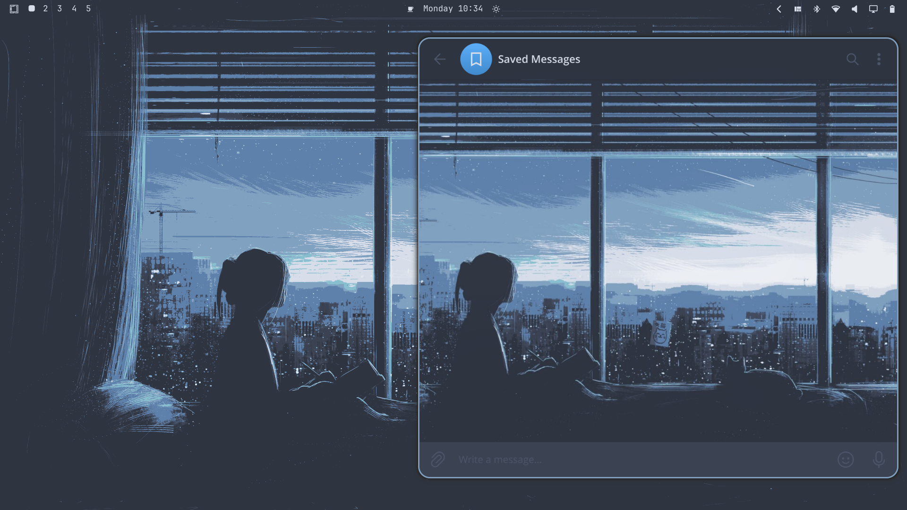

# omarchy-telegram-theme



Keeps Telegram Desktop's colours and chat background in sync with your active Omarchy theme and wallpaper.

Switch themes with omarchy-theme-next or omarchy-theme-set and Telegram follows automatically.

## Install

```bash
omarchy plugin add https://github.com/rahmatov-abdullaxon/omarchy-telegram-theme --enable
```

Force a manual resync any time with:
```bash
omarchy-shell io.github.rahmatov-abdullaxon.telegram-theme resync
```

## Removal

```bash
omarchy plugin remove io.github.rahmatov-abdullaxon.telegram-theme --yes
```

## Requirements

```bash
sudo pacman -S --needed zip imagemagick inotify-tools
```

## License

MIT — see [LICENSE](LICENSE).
